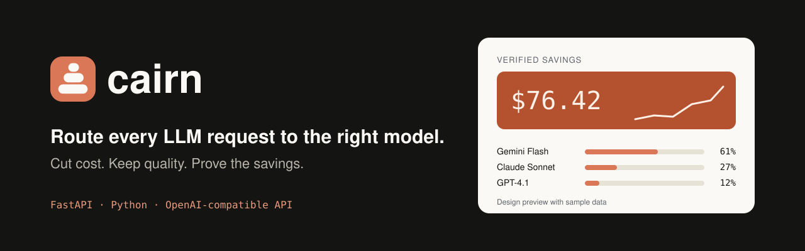

<p align="center">
  
</p>

<p align="center">
  
  
  
  
</p>

# Cairn

**Cairn is an LLM routing gateway.** Your app sends one request to one endpoint. Cairn picks the model that fits the task (by cost, quality, complexity and latency), calls it, and records what the request cost compared with a baseline model, so the savings are measured instead of guessed.

> **Project status:** early development. This README describes the design and the plan. The banner above and the screens below are **design previews with sample data**, not a running product. The status table further down shows what is built and what is not.

## The problem

Teams often send every request to the most capable (and most expensive) model, even when a smaller model would answer just as well. Simple tasks like classification or short summaries do not need a top-tier model, while hard reasoning does. Choosing by hand does not scale, and nobody can prove what the choice saved.

## How Cairn works

```
Your app
   |   one OpenAI-compatible request
   v
+---------------------- Cairn (FastAPI) ----------------------+
| 1. Analyzer  -> task type, complexity, token estimate        |
| 2. Router    -> scores each model, picks the best fit        |
| 3. Executor  -> calls the provider, falls back on failure    |
| 4. Ledger    -> tokens, cost, baseline cost, savings         |
+--------------------------------------------------------------+
   |                                   |
   v                                   v
Gemini / OpenAI / Anthropic        SQLite (Postgres later)
```

**Routing.** Each candidate model gets a fit score from its quality for the task, its estimated cost, its recent latency and the priority you chose (balanced, lowest cost, lowest latency, highest quality). A model must first pass a minimum quality threshold, so cheap never beats good enough. Every decision is stored with the scores of all candidates, so it can be explained.

**Verified savings.** Each workspace picks a baseline model. For every request:

```
savings = cost the baseline model would have had (same tokens) - actual cost
```

## What the interface will look like

Three main screens, designed in a calm ivory, slate and clay palette.

| Screen | What it shows |
|---|---|
| **Overview** | Actual spend, baseline spend, verified savings, traffic by model, recent requests with cost, savings and latency |
| **Playground** | Enter a prompt, choose task and priority, and see the chosen model, the score of every candidate and a short "why this model" explanation |
| **API keys and setup** | Setup checklist, provider keys, baseline model choice and a quickstart snippet |

Screenshots will be added to `docs/screenshots/` once the frontend is built.

## Planned usage

The gateway will be OpenAI-compatible, so switching means changing only the base URL.

```python
from openai import OpenAI

client = OpenAI(
    base_url="http://localhost:8000/v1",   # your Cairn gateway
    api_key="YOUR_CAIRN_KEY",
)

response = client.chat.completions.create(
    model="auto",                           # let Cairn choose
    messages=[{"role": "user", "content": "Summarize this ticket in 3 bullets."}],
)
```

> This is the target interface. It does not work yet.

## Status

| Component | Status |
|---|---|
| FastAPI project skeleton and `/health` endpoint | In progress |
| First real model call through the gateway (Gemini) | Planned |
| Multiple providers behind one format | Planned |
| Model catalog (prices, capabilities) | Planned |
| Rule-based router with explained decisions | Planned |
| Cost ledger with baseline comparison | Planned |
| Benchmark on a prompt set (cost vs. quality) | Planned |
| Playground and dashboard connected to the backend | Planned |
| Fallbacks and retries | Planned |
| Authentication, workspaces, billing | Out of scope for the first version |

## Benchmark

Results will be published here after the benchmark is run on a fixed prompt set, comparing always using one expensive model against Cairn routing. Only measured numbers will be reported, together with the method used.

## Tech stack

- **Backend:** Python, FastAPI, Uvicorn
- **Storage:** SQLite first, PostgreSQL later
- **Providers:** Google Gemini, OpenAI, Anthropic
- **Frontend:** Next.js
- **Tests:** pytest

## Run locally

Windows PowerShell:

```powershell
cd backend
python -m venv .venv
.\.venv\Scripts\Activate.ps1
pip install -r requirements.txt
uvicorn app.main:app --reload
```

Then open http://127.0.0.1:8000/docs, or check the server:

```powershell
Invoke-RestMethod http://127.0.0.1:8000/health
```

## Roadmap

- [x] Product design and UI mockups
- [ ] Gateway skeleton and health endpoint
- [ ] Real model calls through one endpoint
- [ ] Multi-provider adapters
- [ ] Router v1 (rules and capability table)
- [ ] Cost ledger and verified savings
- [ ] Benchmark and results
- [ ] Frontend dashboard and playground
- [ ] Router v2 (small classifier to rate complexity)

## Limitations

- The first version uses a rule-based router. It is a baseline, not a learned model.
- Quality can only be claimed for the tested prompt set, not in general.
- Prices and model capabilities change, so the catalog needs regular updates.

## Author

Built by **Ghayoor**, BS Computer Science graduate (Islamia College Peshawar).

## License

MIT. Add a `LICENSE` file before publishing (GitHub can create it when you add a license in the repo settings).
